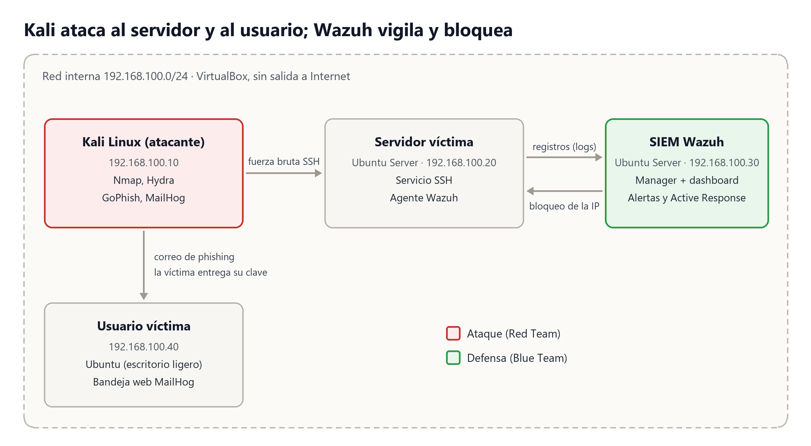

# Credential Threat Detection Lab

A **defensive security** project: detecting SSH brute force, password spraying and phishing-driven account compromise with **Wazuh**, in an isolated
virtual lab — plus an offline Python detector that unit-tests the same logic in CI.

> **Status: v0.1 — design and detection-as-code.** The lab has not been run yet. Rules are written but not yet
> validated in Wazuh, and no measured results are published. See [`docs/test-plan.md`](docs/test-plan.md).
>
> Español: [README.es.md](README.es.md)



## What this project does
The focus is the blue team: detection rules, alert triage, automated response and hardening. Attacks are
simulated only to generate realistic evidence for the defenses.

1. **Simulates** two credential attacks in a closed lab: password guessing against SSH, and a phishing email that
   leads to a login with a stolen password.
2. **Detects** them with three custom Wazuh rules mapped to MITRE ATT&CK (T1110.001, T1078).
3. **Responds** with Wazuh active response (`firewall-drop`), then **hardens** the host (keys + TOTP, fail2ban, ufw).
4. **Compares** round 1 (detection only) with round 2 (controls on).

The key idea: the SIEM never sees the phishing email, only its consequence — a valid login from a source that
should not be logging in. So the allowlist rule matters as much as the brute-force rule.

## Repository layout
```
detector/          Python detector + pytest suite (runs in CI, no SIEM needed)
samples/           Hand-written synthetic sshd logs for round 1 and round 2
wazuh/rules/       local_rules.xml  (rules 100100-100102)
wazuh/active-response/  ossec.conf snippet for firewall-drop
hardening/         sshd config, fail2ban jail, ufw script, MFA guide
docs/              architecture, threat model, detection, test plan, phishing exercise, ethics, roadmap
```

## Try the detector
```bash
cd detector
pip install pytest
python -m pytest -q
python -m authlog_detector ../samples/auth_round1_synthetic.log --allow 192.168.100.50/32 --year 2026
```
Expected output on the synthetic round-1 log:
```
ssh_brute_force                T1110.001  192.168.100.10  5 failed logins in 60s
ssh_password_spraying          T1110.003  192.168.100.10  4 distinct users targeted in 60s
ssh_success_after_failures     T1078      192.168.100.10  login succeeded after 10 failures from the same IP
ssh_login_unauthorized_source  T1078      192.168.100.10  successful login from a source outside the allowlist
```

## Detections
| Rule | Wazuh | Logic | ATT&CK |
|---|---|---|---|
| Brute force | 100100 | ≥5 failures from one IP in 60 s | T1110.001 |
| Password spraying | Python only (v0.2 in Wazuh) | ≥4 usernames from one IP in 60 s | T1110.003 |
| Non-allowlisted login | 100101 | SSH success from an IP other than the admin workstation | T1078 |
| Success after failures | 100102 | Success after a brute-force alert from the same IP | T1078 |

## Scope and ethics
Isolated VirtualBox internal network, fictitious accounts and data only. This repository publishes defensive
material (rules, hardening, synthetic logs); it does not include attack tooling, wordlists or phishing templates.
See [`docs/ethics-and-scope.md`](docs/ethics-and-scope.md).

## Background
Identity-based techniques (compromised credentials, brute force, phishing) were the most common initial-access
root cause in Sophos' 2026 Active Adversary Report; in Verizon's 2026 DBIR, phishing and credential abuse together
account for about 29 % of initial access. Started as a group project for *Seguridad Informática*,
Universidad de Guayaquil (Software Engineering).

## Team
Arturo José Vásquez Cubero (coordination, detector, docs) · Jorge Delgado Aguilar · Anderson Antanas Espinosa Feijoo ·
Dean Jaher León Paucar · Gabriel Alejandro Mendoza Navarrete

Drafted with assistance from Claude (Anthropic); design decisions, lab work and review by the team.

## License
MIT
