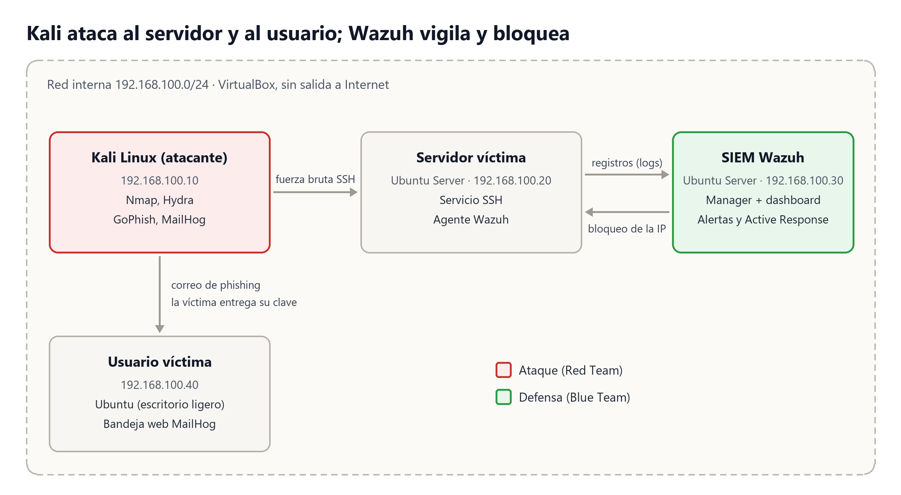

# Architecture

| VM | OS | IP | Role |
|---|---|---|---|
| attacker | Kali Linux | 192.168.100.10 | Red team: reconnaissance, password-guessing test, phishing simulation |
| victim | Ubuntu Server | 192.168.100.20 | OpenSSH + small web login, Wazuh agent |
| siem | Ubuntu Server | 192.168.100.30 | Wazuh manager, indexer and dashboard |
| user | Ubuntu desktop | 192.168.100.40 | Fictitious user who receives the test email (local MailHog inbox) |
| admin | any | 192.168.100.50 | Only workstation allowed to log in over SSH |

- VirtualBox **internal network**: no route to the Internet or to any real network.
- All accounts, passwords and emails are fictitious and created for the lab.
- Data flow: `sshd` → `/var/log/auth.log` → Wazuh agent → manager → rules `100100–100102` → alert → (round 2) `firewall-drop` on the victim.
